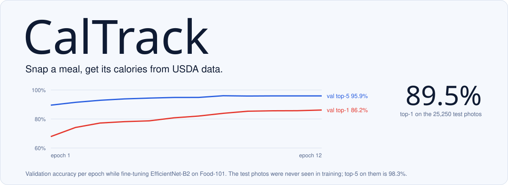
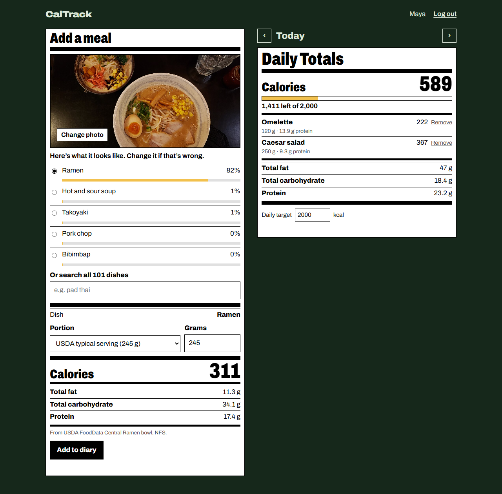
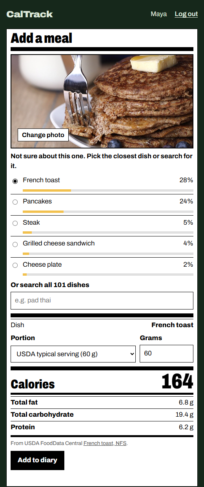

<picture>
  <source media="(prefers-color-scheme: dark)" srcset="docs/readme/banner-dark.svg">
  
</picture>

CalTrack is a food diary that starts from a photo. A fine-tuned EfficientNet-B2 recognises the dish, USDA FoodData Central supplies the nutrition, and you confirm the portion before it goes into your day.



## How well it recognises food

The classifier knows the 101 dishes in [Food-101](https://data.vision.ee.ethz.ch/cvl/datasets_extra/food-101/). On the dataset's 25,250 test photos, none of which it saw during training:

| | |
|---|---|
| Right first guess (top-1) | **89.5%** |
| Right dish somewhere in its five guesses (top-5) | **98.3%** |
| Easiest dishes | edamame 100%, macarons 98.8%, spaghetti bolognese 98.0%, pad thai 97.6% |
| Hardest dishes | steak 66.4%, pork chop 71.2%, chocolate mousse 72.0%, apple pie 73.2% |

Those numbers come from PyTorch. The app runs the exported ONNX model in Node with its own image resizing, so I scored that path separately on 1,010 test photos (10 per dish). It got the same 89.5% and 98.3%.

Test photos come from the same website as the training photos, so I also tried eight CC0 photos from Wikimedia Commons:

| Photo | First guess | |
|---|---|---|
| [Pizza](https://commons.wikimedia.org/wiki/File:Tomato_onion_pizza.jpg) | pizza 90% | right |
| [Sushi](https://commons.wikimedia.org/wiki/File:2009,_sushi_in_Otaru.jpg) | sushi 87% | right |
| [Caesar salad](https://commons.wikimedia.org/wiki/File:Caesar_Salad_-_Purezza_2023-11-22.jpg) | caesar salad 85% | right |
| [Ramen](https://commons.wikimedia.org/wiki/File:Soy_Milk_Ramen_and_Tonkotsu_Miso_Ramen_by_Goemon_Ramen_Bar.jpg) | ramen 82% | right |
| [Waffles](https://commons.wikimedia.org/wiki/File:Buttermilk_waffles_with_crispy_bacon_-_Ren%27s_Kitchen_2026-03-14.jpg) | waffles 67% | right |
| [Hamburger](https://commons.wikimedia.org/wiki/File:Hamburger_(black_bg).jpg) | hamburger 42% | right, but flagged as unsure |
| [Pancakes](https://commons.wikimedia.org/wiki/File:Slicing_Pancakes_with_Fork_374819.jpg) | french toast 28% | wrong; pancakes was second at 24% |
| [Pad thai](https://commons.wikimedia.org/wiki/File:Thai-Pad-Thai_2023-06-04.jpg) | omelette 20% | wrong; not in the top three |

When the first guess is under 50%, the app says it isn't sure and asks you to pick from the five guesses or search all 101 dishes by name, instead of quietly logging its guess:



## Where the calories come from

Every dish maps to USDA FoodData Central survey foods (FNDDS 2021–2023), and the label links to the exact record. 82 dishes have a direct USDA match. The other 19, such as poutine, risotto and Caesar salad, are blended from several USDA records by weight. They're marked "Approximate" and use a serving size I estimated. The mapping is in [`scripts/build_nutrition.py`](scripts/build_nutrition.py).

**The portion matters more than the model.** A photo can't tell 200 g of pad thai from 400 g, so CalTrack doesn't pretend to. It suggests USDA's typical serving, the weight USDA's dietary survey uses when someone doesn't say how much they ate, and lists USDA's other portion sizes. For soups and noodle dishes that typical serving is one cup, about half a restaurant bowl, so there's a "2 cups" option too. Type the grams if you know them. Nutrition is always worked out on the server from the dish and the grams.

## Run it

You need Node 20 or newer.

```sh
cd backend
npm install
npm run demo
```

Open http://127.0.0.1:5500 and create an account. The demo runs an in-memory MongoDB (downloaded on first run) with a throwaway signing key, so everything is gone when you stop it.

To keep data, create `backend/.env`:

```sh
MONGO_URI=mongodb://127.0.0.1:27017/caltrack
JWT_SECRET=<any long random string>
```

Then run `npm start`. `npm test` runs the API tests, including one that runs a photo through the real model.

## API

All routes except signup and login need `Authorization: Bearer <token>`.

| Route | |
|---|---|
| `POST /api/auth/signup`, `POST /api/auth/login` | `{ name, email, password }` → `{ token, user }` |
| `GET /api/auth/me`, `PATCH /api/auth/me` | read or set `{ dailyTarget }` (800–6000 kcal) |
| `POST /api/food/analyze` | multipart `image` (≤ 10 MB) → five guesses with confidence and nutrition |
| `GET /api/food` | all 101 dishes with per-100 g values, portions and USDA sources |
| `GET /api/meals?day=YYYY-MM-DD` | that day's meals and totals |
| `POST /api/meals` | `{ food, grams, day }`; nutrition is computed on the server |
| `DELETE /api/meals/:id` | remove one of your meals |

Photos are classified in memory and discarded; they're never written to disk.

## Training the model

The ONNX model (31 MB) is committed, so you only need this to retrain. It used an RTX 4060 Laptop GPU, at about 7½ minutes an epoch.

```sh
python -m venv model/.venv
model/.venv/Scripts/python -m pip install torch torchvision --index-url https://download.pytorch.org/whl/cu128
model/.venv/Scripts/python -m pip install onnx onnxscript onnxruntime
model/.venv/Scripts/python model/train.py --data path/to/datasets   # the folder containing food-101/
```

`train.py` fine-tunes ImageNet EfficientNet-B2 at 260 px for 12 epochs with AdamW, a one-cycle schedule, label smoothing and TrivialAugment. It holds back 5% of the training photos to pick the best epoch, scores the test set once, and writes [`model/metrics.json`](model/metrics.json). Then it exports `backend/model/food101-effnetb2.onnx` and checks that the ONNX output matches PyTorch. This run was interrupted twice, after epochs 4 and 9, and resumed with `--resume` on the same learning-rate schedule.

## History

The first version of CalTrack, in 2024, was a notebook CNN and an Express app whose analyze endpoint returned random calories. The notebook's "84.5% validation accuracy" was measured on the same folder it trained on, so it didn't measure anything. Those notebooks are in the git history. This version replaces both the model and the app.

Food-101 is by Bossard, Guillaumin and Van Gool (ECCV 2014). USDA FoodData Central data is public domain.
